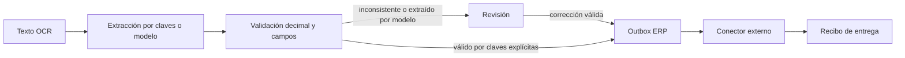

# Recepción y entrega de facturas

El servicio persiste factura, evento de auditoría y salida pendiente dentro de la misma transacción de solicitud. El adaptador HTTP almacena la respuesta junto a la clave de idempotencia. La extracción con modelo, cuando se solicita, devuelve datos no confiables que vuelven a pasar por la validación contable y requieren contraste humano con el documento fuente. La coherencia de los importes no verifica la extracción.

`invoices` mantiene los campos normalizados y el estado. `erp_outbox` mantiene una única salida por documento y el recibo externo. La entrega no se infiere de la lectura del outbox: el conector debe confirmar únicamente después de obtener una respuesta verificable del ERP y reutilizar el identificador del documento en sus reintentos.

Los estados son `manual_review`, `validated`, `rejected` y `exported`. Un documento validado no vuelve a revisión mediante esta API. Cambios posteriores deben modelarse como documentos correctivos para conservar la trazabilidad.

Los logs de auditoría no guardan el texto OCR. La base sí contiene los campos extraídos y debe tratarse como información empresarial. La instancia local utiliza una sola base SQLite; el procesamiento masivo requiere una cola y un adaptador de persistencia que conserve las restricciones de unicidad.
