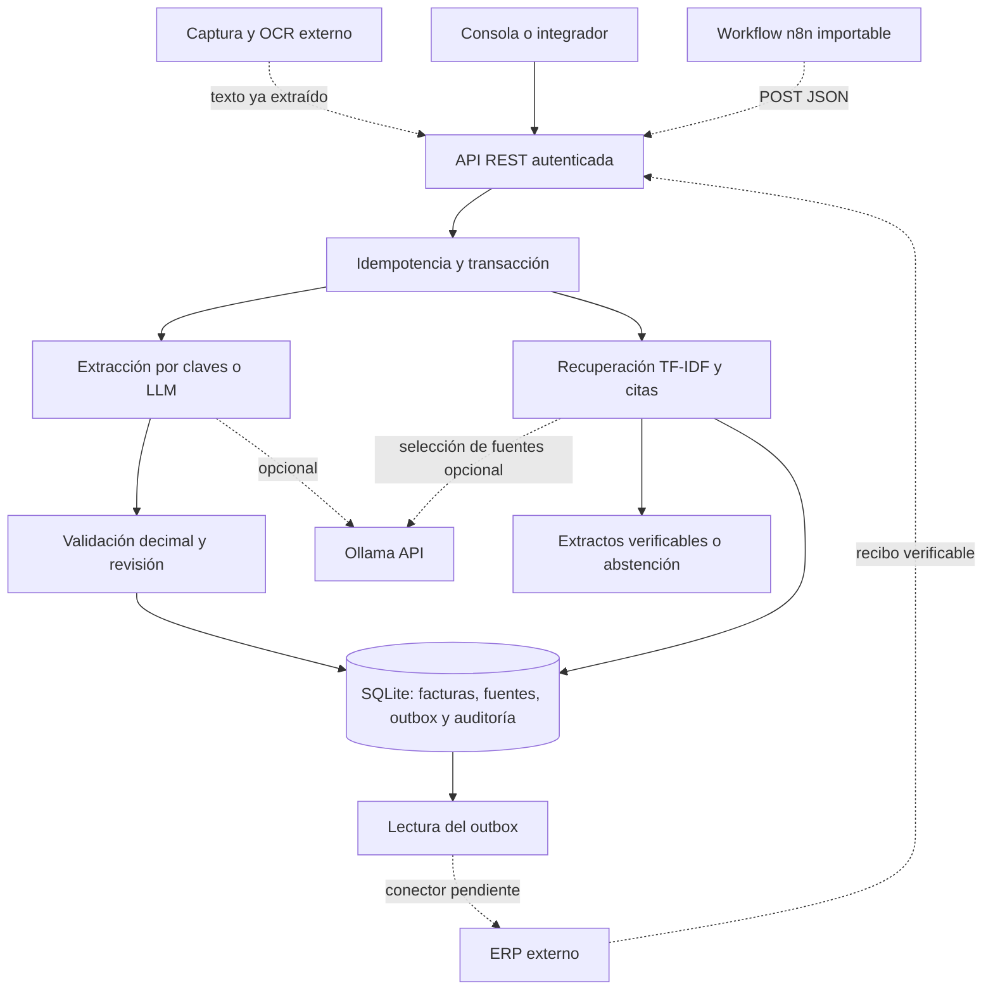

# Arquitectura

[Abrir SVG](diagrams/architecture.svg) · [Fuente Mermaid](diagrams/architecture.mmd)

La API separa extracción, control contable, consulta documental y entrega. SQLite conserva factura, versión de la fuente, auditoría y salida ERP en la misma transacción. La recuperación consulta únicamente documentos validados o exportados, salvo que un operador solicite incluir pendientes.

Versión Mermaid

## Componentes

| Componente | Responsabilidad |
| --- | --- |
| `app/runtime.py` | Token, límites HTTP, transacción y repetición segura de solicitudes. |
| `app/domain.py` | Campos, aritmética decimal, duplicados, revisión y confirmación ERP. |
| `app/retrieval.py` | Índice de registros normalizados, versiones, ranking y citas. |
| `app/providers.py` | Adaptador opcional de Ollama con salida estructurada. |
| `workflows/intake.json` | Entrada autenticada de n8n y llamada a la API. |

El servicio persiste factura, fuente, auditoría y salida pendiente dentro de la misma transacción. `invoice_sources` guarda una instantánea de los campos actuales y su estado. Una corrección o cambio de estado actualiza la versión; una repetición idéntica no la incrementa. Las facturas anteriores a esta funcionalidad se indexan al recibir la siguiente operación.

El LLM puede extraer campos sujetos a revisión o seleccionar identificadores entre las fuentes recuperadas. La respuesta documental se compone con extractos exactos del índice: el modelo no genera importes nuevos, aprueba facturas ni ejecuta instrucciones de los documentos. Una referencia inexistente produce abstención en lugar de recuperar otra factura por palabras genéricas.

`invoices` mantiene los campos normalizados y el estado. `erp_outbox` mantiene una única salida por documento y el recibo externo. La entrega no se infiere de la lectura del outbox: el conector debe confirmar únicamente después de obtener una respuesta verificable del ERP y reutilizar el identificador del documento en sus reintentos.

Los estados son `manual_review`, `validated`, `rejected` y `exported`. Un documento validado no vuelve a revisión mediante esta API. Cambios posteriores deben modelarse como documentos correctivos para conservar la trazabilidad.

## Límites de integración

La instancia representa una organización y comparte un token de integración. Para organizaciones aisladas se necesita una base y credencial independientes, o incorporar identidad y partición antes del ranking. No ofrece autorización individual por empleado.

Los logs no guardan el OCR completo. La base sí contiene campos extraídos y debe tratarse como información financiera. Los extractos pueden conservarse en respuestas idempotentes; cambiar la versión del índice no elimina ese historial. El motor OCR, el conector ERP y las credenciales n8n/Ollama se configuran fuera de la demo.

[Flujo de operación](flow.md) · [Tecnologías](technologies.md) · [Decisiones](decisions.md)
