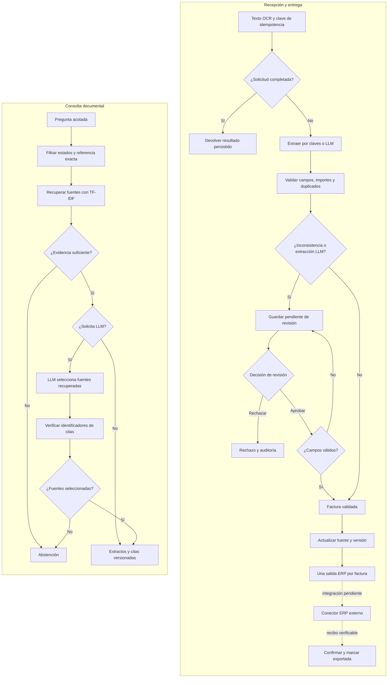

# Flujo de operación

[Abrir SVG](diagrams/flow.svg) · [Fuente Mermaid](diagrams/flow.mmd)

La recepción valida y clasifica documentos antes de crear la salida ERP. La consulta documental utiliza las instantáneas versionadas y no modifica decisiones contables.

Versión Mermaid

La aritmética se resuelve con `Decimal`. Una extracción con modelo exige revisión incluso si las sumas coinciden. Una aprobación con correcciones inválidas revierte la solicitud y conserva el documento pendiente; sólo la decisión explícita de rechazo lo marca como rechazado. Leer el outbox no acredita entrega: el conector ERP está pendiente de integración y debe aportar un recibo externo.

Cada cita incluye documento, versión, estado y extracto. Los pendientes se excluyen por defecto y los rechazados nunca se recuperan. Un modelo sólo puede seleccionar fuentes recuperadas; no puede inventar citas, corregir importes ni ejecutar acciones.

[Arquitectura](architecture.md) · [Tecnologías](technologies.md)
